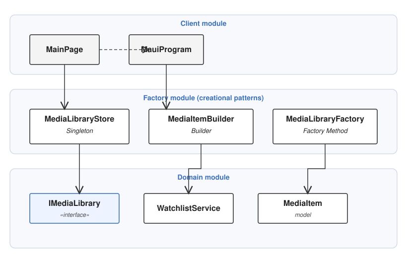
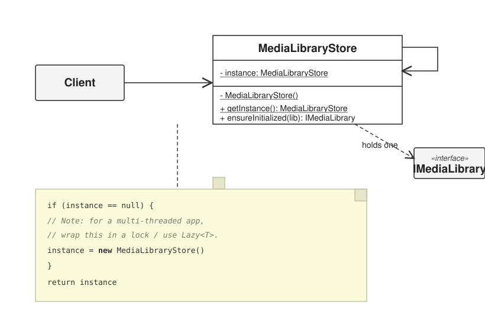
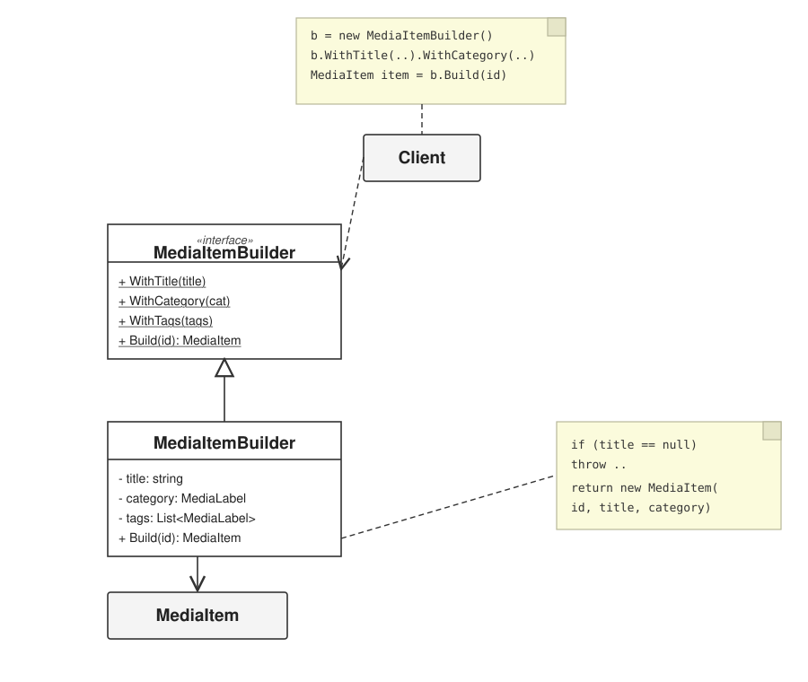
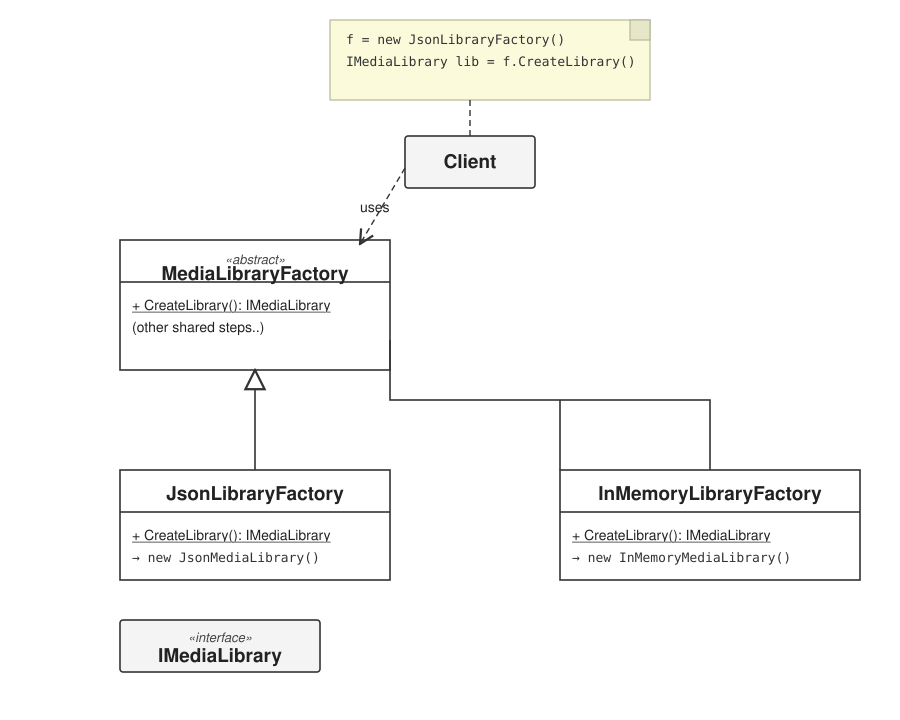

# Lab 1 — Creational Design Patterns

## Topic: *Creational Design Patterns*
**Course:** Tehnici și Mecanisme de Proiectare Software (TMPS)  
**Author:** Dinu Pleșu, FAF241  
**Technology:** C# and .NET 9 MAUI (Android)  
**Year:** 2026

---

## Objectives

1. Study and understand the Creational Design Patterns.
2. Choose a domain, define its main classes/models/entities and choose the appropriate instantiation mechanisms.
3. Use some creational design patterns for object instantiation in a sample project.

---

## Some Theory

In software engineering, the creational design patterns are the general solutions that deal with object creation, trying to create objects in a manner suitable to the situation. The basic form of object creation could result in design problems or added complexity to the design. Creational design patterns solve this problem by optimizing, hiding or controlling the object creation.

Examples of this kind of design patterns are:

* **Singleton**
* **Builder**
* **Prototype**
* **Object Pooling**
* **Factory Method**
* **Abstract Factory**

This lab implements three of them: **Singleton**, **Builder** and **Factory Method**.

---

## Domain

This lab reuses the **Consumed Media Watchlist** domain from Lab 0, but simpler and running as a **.NET MAUI** app that targets Android. The application lets you add media titles (films, shows, books, games), organize them with categories and tags, mark them as consumed, and rate them from 1 to 10.

The project is split into modules by responsibility:

```text
Lab1/
├── MauiProgram.cs            composition root (client wiring)
├── App.xaml / AppShell.xaml  MAUI application shell
├── MainPage.xaml(.cs)        client / UI
├── Domain/
│   ├── Models/               MediaItem, MediaLabel
│   ├── Abstractions/         IMediaLibrary, IMediaScoreCalculator
│   ├── Storage/              InMemoryMediaLibrary, JsonMediaLibrary
│   ├── Scoring/              RatingScoreCalculator
│   └── Services/             WatchlistService
└── Factory/                  ← the creational patterns live here
    ├── Singleton/            MediaLibraryStore
    ├── Builder/              MediaItemBuilder
    └── FactoryMethod/        MediaLibraryFactory
```

| Module | Responsibility |
|---|---|
| **client** | `MainPage` — reads input and displays the watchlist |
| **domain** | models, storage, scoring and use-case coordination |
| **factory** | the creational patterns used to instantiate objects |
| **models** | `MediaItem`, `MediaLabel` |



---

## The creational patterns used

### 1. Singleton — `Factory/Singleton/MediaLibraryStore.cs`

Guarantees one shared library for the whole app. `Lazy<T>` with `ExecutionAndPublication` makes instance creation thread-safe.

```csharp
public static MediaLibraryStore Instance => LazyInstance.Value;
private MediaLibraryStore() { }                    // private constructor
public IMediaLibrary EnsureInitialized(IMediaLibrary library) =>
    Library ??= library;                           // only the first call wins
```



### 2. Builder — `Factory/Builder/MediaItemBuilder.cs`

Assembles a `MediaItem` step by step with a fluent API and validates required parts in `Build()`.

```csharp
var item = new MediaItemBuilder()
    .WithTitle(title)
    .WithCategory(categoryLabel)
    .WithTags(tagLabels)
    .Build(id);
```



### 3. Factory Method — `Factory/FactoryMethod/MediaLibraryFactory.cs`

Defers storage instantiation to subclasses, so the client never hard-codes which library it gets.

```csharp
public abstract class MediaLibraryFactory
{
    public abstract IMediaLibrary CreateLibrary();
}

public sealed class JsonLibraryFactory : MediaLibraryFactory
{
    public override IMediaLibrary CreateLibrary() => new JsonMediaLibrary();
}
```



A full report is available at [`Reports/Lab1.md`](../Reports/Lab1.md).

---

## Running the project

Requires the **.NET 9 SDK** with the MAUI Android workload:

```powershell
dotnet workload install maui-android
dotnet build Lab1/Lab1.csproj -f net9.0-android
```

To produce an installable Android APK:

```powershell
dotnet publish Lab1/Lab1.csproj -c Release -f net9.0-android -p:AndroidKeyStore=false
```

---

## Continuous integration

The GitHub Actions workflow [`.github/workflows/lab1-android.yml`](../.github/workflows/lab1-android.yml) builds the Android APK on every `v*` tag (or manually via **workflow_dispatch**), uploads it as an artifact, and attaches it to a **GitHub Release** automatically.

---

## Evaluation checklist

- [x] Repository on a git hosting service (GitHub).
- [x] Separated into modules by responsibility: `client`, `domain` (with `factory` and `models`).
- [x] At least 3 creational design patterns implemented (Singleton, Builder, Factory Method).
- [x] README + report with explanation and standard structure.
- [x] CI that builds the app and publishes a release.
