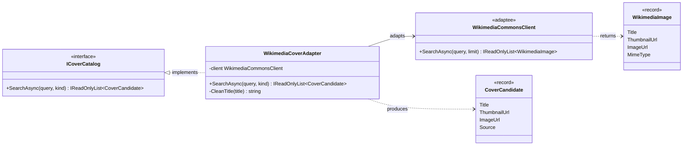
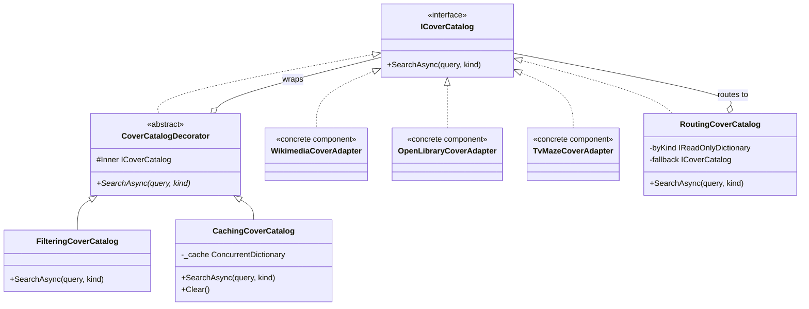
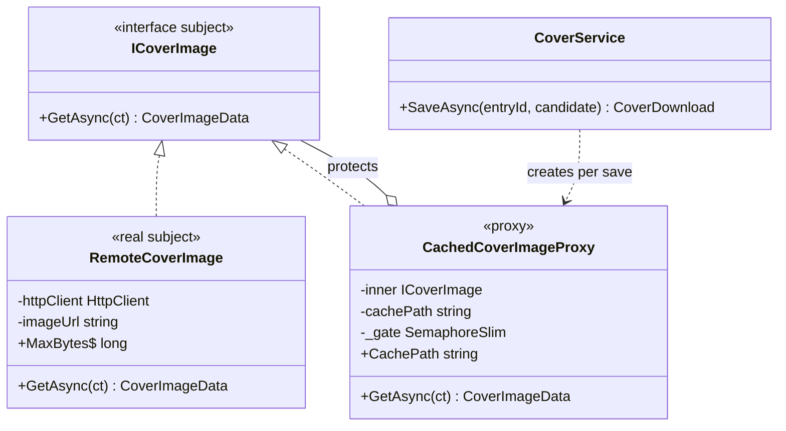

# Lab 2 Report — Structural Design Patterns

**Course:** TMPS · **Author:** Pleșu Dinu (FAF241) · **Technology:** C# / .NET 10, MAUI Android client
**Repository:** `Lab2/Core` (shared library), `Lab2/App` (Android client), `Tests/Watchlist.Tests` (unit tests)

## Objectives

- Explain the intent of each structural pattern and the problem it solves.
- Recognise where a structural pattern fits naturally in a codebase, and where it would be forced.
- Implement the patterns so client code depends on abstractions, not concrete classes.
- Show that the design is open to extension: new variants are added without editing existing classes.
- Defend design choices and adapt the code to a new requirement during the defence.

## Task

Implement **at least three** structural patterns in one project, and learn the rest that were not implemented.

Implemented here: **Adapter**, **Decorator**, **Proxy**. Not implemented: Bridge, Composite, Facade (only a partial use-case object, see §6), Flyweight. Their intent and where they would fit are in §9.

## Theory

Structural patterns describe how classes and objects are composed into larger structures while keeping those structures flexible.

- **Adapter** converts one interface into the one a client expects, so incompatible code can work together.
- **Decorator** wraps an object that already has an interface and adds responsibilities at run time, in any order.
- **Proxy** stands in for a real object with the same interface and controls access to it (caching, checks, lazy loading).

The common rule is that a client talks to an interface (`ICoverCatalog`, `ICoverImage`). Whether the object behind it is a provider adapter, a decorator, or a proxy is invisible to the client.

## 1. Domain description

The application is a personal **watchlist** of films, series, anime, manga, books and games. Each entry has a title, kind, category, tags, status (Planned, Consumed, Rated), an optional rating, notes, and a **cover image**. Entries are stored as human-readable Markdown files in a local vault, with covers as image files next to them.

Lab 2 adds the **cover search**: the user searches a public provider for a poster or cover, sees thumbnails, picks one, and the image is downloaded once and stored in the vault. Lab 2 is the structural part of that pipeline.

## 2. Project structure

```text
Lab2/
├── Core/                        shared library (no UI code)
│   ├── Domain/                  MediaItem, MediaItemBuilder (Lab 1 Builder), MediaKind, MediaStatus
│   ├── Storage/                 Markdown vault: entry codec, repository, migrator
│   └── CoverSearch/
│       ├── ICoverCatalog.cs     Target interface used by every client
│       ├── RoutingCoverCatalog  picks a provider per media kind
│       ├── CoverServiceFactory  assembles the pipeline in one place
│       ├── CoverService         use case: search, then save through the proxy
│       └── Patterns/            one folder per pattern
│           ├── Adapter/         WikimediaCoverAdapter, OpenLibraryCoverAdapter, TvMazeCoverAdapter
│           │   └── Adaptees/    the three public API clients (adaptees)
│           ├── Decorator/       CoverCatalogDecorator, FilteringCoverCatalog, CachingCoverCatalog
│           └── Proxy/           ICoverImage, RemoteCoverImage (real subject), CachedCoverImageProxy
├── App/                         .NET MAUI Android client (pages only, no pattern wiring)
│   ├── MainPage, EditPage, CoverPickerPage, PatternsPage
│   └── AppServices.cs           asks the Core factory for a CoverService
Tests/Watchlist.Tests/           CoverPatternTests and the other unit tests
```

The client never builds providers, adapters or decorators. `AppServices` calls `CoverServiceFactory.Create(...)` and receives a `CoverService`. This keeps creation inside the functionality, not in the client.

## 3. Adapter

### Intent and the real problem

The public Wikimedia Commons API returns `query.pages[]` records with `imageinfo`, `thumburl`, `mime`. The application's search (`ICoverCatalog`) only understands `CoverCandidate(Title, ThumbnailUrl, ImageUrl, Source)`. Without an adapter, the search code would parse Wikimedia JSON shapes and clean titles (`File:` prefix, underscores, extension), and would have to do it again for Open Library and TVmaze.

The adaptee is a library the project does not own: the Wikimedia API. Its models are not changed.

### Class diagram



The same shape is used for `OpenLibraryCoverAdapter` → `OpenLibraryClient` and `TvMazeCoverAdapter` → `TvMazeClient`.

### Code where the pattern is visible

[`Lab2/Core/CoverSearch/Patterns/Adapter/WikimediaCoverAdapter.cs`](Lab2/Core/CoverSearch/Patterns/Adapter/WikimediaCoverAdapter.cs):

```csharp
public sealed class WikimediaCoverAdapter(WikimediaCommonsClient client) : ICoverCatalog
{
    public async Task<IReadOnlyList<CoverCandidate>> SearchAsync(
        string query,
        MediaKind kind,
        CancellationToken cancellationToken = default)
    {
        if (string.IsNullOrWhiteSpace(query))
        {
            return [];
        }

        var images = await client.SearchAsync(query, cancellationToken: cancellationToken);
        return images
            .Where(image => image.MimeType.StartsWith("image/", StringComparison.OrdinalIgnoreCase))
            .Where(image => !image.MimeType.Contains("svg", StringComparison.OrdinalIgnoreCase))
            .Select(image => new CoverCandidate(
                CleanTitle(image.Title),
                image.ThumbnailUrl,
                image.ImageUrl,
                "Wikimedia Commons"))
            .ToArray();
    }
}
```

The adapter translates the adaptee's model into the target `CoverCandidate`, so the rest of the app never sees Wikimedia JSON. The sheet's "adapt a library you cannot change" rule is met: Wikimedia Commons is a public API this project does not own.

### Tests

- `Wikimedia_adapter_maps_foreign_response_to_cover_candidates`: checks the mapping from `WikimediaImage` to `CoverCandidate`, including the title cleaning.
- `OpenLibrary_adapter_skips_books_without_a_cover_id`: checks that an Open Library record with no cover id is dropped, not mapped.

## 4. Decorator

### Intent and the real problem

Every cover search needs the same two extras: only usable hits (valid HTTP links, no SVG/TIFF/PDF, no duplicates, at most 20 results) and a cache so that repeating a query does not call the provider again. Putting these checks inside each adapter would duplicate them. A decorator adds them on top of any `ICoverCatalog`, in any order.

### Class diagram



### Code where the pattern is visible

[`Lab2/Core/CoverSearch/Patterns/Decorator/CachingCoverCatalog.cs`](Lab2/Core/CoverSearch/Patterns/Decorator/CachingCoverCatalog.cs):

```csharp
public sealed class CachingCoverCatalog(ICoverCatalog inner) : CoverCatalogDecorator(inner)
{
    private readonly ConcurrentDictionary<string, IReadOnlyList<CoverCandidate>> _cache = new();

    public override async Task<IReadOnlyList<CoverCandidate>> SearchAsync(
        string query, MediaKind kind, CancellationToken cancellationToken = default)
    {
        var key = $"{kind}:{query.Trim().ToLowerInvariant()}";
        if (_cache.TryGetValue(key, out var cached))
        {
            return cached;
        }

        var hits = await Inner.SearchAsync(query, kind, cancellationToken);
        if (hits.Count > 0)
        {
            _cache[key] = hits;
        }

        return hits;
    }
}
```

The decorator has the same interface as what it wraps, so `FilteringCoverCatalog(CachingCoverCatalog(...))` and the reverse order both work. The factory picks `Filtering -> Caching -> Routing -> Adapter`. The filter sits outside the cache, so the cache stores raw provider hits.

Adding a new variant (for example a rate limiter) means one new class that derives from `CoverCatalogDecorator`. No existing class changes.

### Tests

- `Caching_decorator_avoids_a_second_provider_call`: the second identical search does not reach the inner catalog.
- `Filtering_decorator_removes_invalid_duplicate_and_svg_hits`: blank titles, non-HTTP links, SVG hits and duplicate URLs are removed.
- `Decorators_can_be_stacked_in_either_order`: both orders give the same result.

## 5. Proxy

### Intent and the real problem

Saving a cover downloads a file from the internet. Before downloading, the app must check whether the file is already in the vault, reject oversized or non-image payloads, and avoid two parallel downloads of the same cover. A **proxy** keeps the `ICoverImage` contract and does those checks before it reaches the real subject, so the caller cannot skip them.

### Class diagram



### Code where the pattern is visible

[`Lab2/Core/CoverSearch/Patterns/Proxy/CachedCoverImageProxy.cs`](Lab2/Core/CoverSearch/Patterns/Proxy/CachedCoverImageProxy.cs), abridged:

```csharp
public sealed class CachedCoverImageProxy(
    ICoverImage inner,
    string cachePath,
    long maxBytes = RemoteCoverImage.MaxBytes) : ICoverImage
{
    private readonly SemaphoreSlim _gate = new(1, 1);

    public async Task<CoverImageData> GetAsync(CancellationToken cancellationToken = default)
    {
        await _gate.WaitAsync(cancellationToken);
        try
        {
            if (File.Exists(cachePath))
            {
                var cached = await File.ReadAllBytesAsync(cachePath, cancellationToken);
                if (cached.Length > 0 && cached.Length <= maxBytes)
                {
                    return new CoverImageData(cached, CoverImageTypes.ContentTypeForPath(cachePath), cachePath);
                }
                File.Delete(cachePath);
            }

            var downloaded = await inner.GetAsync(cancellationToken);
            // size and image-signature checks, then write to a temp file and move it into place
            ...
        }
        finally
        {
            _gate.Release();
        }
    }
}
```

The proxy checks the cache before the download, validates size and content, and serialises concurrent requests for the same cover. `CoverService.SaveAsync` always goes through the proxy, so a second selection is instant.

### Tests

- `Proxy_downloads_once_then_serves_the_cached_file`: the subject is called once across two requests.
- `Proxy_rejects_a_payload_that_is_not_an_image`: a non-image payload is refused and nothing is written.
- `Proxy_serializes_concurrent_requests_for_the_same_cover`: two concurrent requests produce one download.
- `Cover_service_uses_the_proxy_cache_for_a_second_save`: the second save reads the cached file.

## 6. How the patterns interact

The sheet requires at least one execution path through two or more patterns. In this project, the **search** path and the **save** path both cross patterns:

```text
Search (user types "The Matrix poster")
  client → CoverService.SearchAsync            (use-case object; a Facade-like entry point)
    → FilteringCoverCatalog                    (Decorator)
      → CachingCoverCatalog                    (Decorator)
        → RoutingCoverCatalog                  (routes Film → Wikimedia)
          → WikimediaCoverAdapter              (Adapter)
            → WikimediaCommonsClient           (adaptee, public API)

Save (user picks a result)
  client → CoverService.SaveAsync
    → CachedCoverImageProxy                    (Proxy: cache check, size and signature checks)
      → RemoteCoverImage                       (real subject, HTTP download)
```

The client calls `ICoverCatalog.SearchAsync` and `ICoverImage.GetAsync`. It never names an adapter, decorator or proxy. `CoverService` is a use-case object. It is not a full Facade, because it does not hide the vault or the UI, and this report does not claim it is.

## 7. Reuse from Lab 1

`MediaItemBuilder` is the Lab 1 Builder. It assembles a valid `MediaItem` step by step (title, kind, category, tags, status, cover path and source). The structural pipeline creates entries through this builder, so no pattern code constructs `MediaItem` objects directly.

## 8. Runnable demo

The sheet asks for a runnable demo with readable output, and says that a GUI gives no extra points. This project's client is an Android app. It was run on the `Medium_Phone_API_37` emulator:

1. Added "The Matrix".
2. Opened **Cover**, searched for `The Matrix poster`.
3. The request passed through the Filtering → Caching → Routing → Wikimedia Adapter chain and returned provider hits.
4. Selected a result. `CachedCoverImageProxy` downloaded and stored `covers/0001.png`.
5. The card reloaded with the cover, status and category.


The cover search result list, from the Cover page (Wikimedia results for "The Matrix poster"):


The **Patterns** page prints the route each pattern takes, so the interaction can be read on the device:


The vault stays plain Markdown plus image files:

```text
files/library/
  entries/0001-the-matrix.md
  covers/0001.png
```

**Gap:** the sheet's "readable console output" is not met by the current repository. The console demo was removed when the client moved to Android. A console runner in `Lab2/Core` can be added if the sheet is strict about it.

## 9. Patterns not implemented

- **Bridge.** Would separate the cover search abstraction (`ICoverCatalog`) from its implementation, so that search by kind and search by provider could vary independently. Not needed here, because routing already selects the provider.
- **Composite.** Would let a group of catalogs (for example, "all providers") be used through `ICoverCatalog` like one catalog. A fan-out catalog could do this. The current design only routes, so there is no tree to model.
- **Facade.** A single simple interface over a complex subsystem. `CoverService` plus `CoverServiceFactory` come close, but they do not hide the storage layer or the UI, so the report does not claim the full pattern.
- **Flyweight.** Would share immutable data between many objects, such as the same `CoverCandidate` values across many cached searches. The cache holds lists, not shared items, so the pattern is not present.

## 10. Tests and evidence

Command (run from the repository root):

```powershell
dotnet test Tests/Watchlist.Tests/Watchlist.Tests.csproj
```

Result on this repository: `Passed! - Failed: 0, Passed: 55, Skipped: 0, Total: 55`. The cover-pattern tests are in `Tests/Watchlist.Tests/CoverPatternTests.cs`: Adapter (2), Decorator (3), Proxy (4), and the factory pipeline (2).

## 11. Requirements checklist

| Requirement | Status |
|---|---|
| At least 3 structural patterns, full structure | Adapter, Decorator (abstract base + 2 concrete), Proxy |
| Patterns interact (one path through 2+ patterns) | Yes, §6 search and save paths |
| Client code depends on abstractions | Yes, `ICoverCatalog`, `ICoverImage` |
| Open for extension | Yes, a new decorator or adapter needs new classes only |
| Build on Lab 1 | Yes, `MediaItemBuilder` (Builder) |
| Clean project structure | Yes, §2 |
| Runnable demo with readable console output | Partial: Android demo with screenshots; console runner removed (see §8) |
| Adapt a library you cannot change | Yes, Wikimedia, Open Library and TVmaze public APIs |
| 2+ unit tests per pattern | Yes, §3–§5 and §10 |
| UML class diagram per pattern | Yes, §3–§5 (Mermaid) |
| Code snippet per pattern with explanation | Yes, §3–§5 |
| Common mistakes avoided | Adapter adapts a foreign API; Decorator wraps the same interface; Proxy keeps the same interface; no `instanceof` checks on the client side |

## 12. Conclusions

- The hardest part was the decorator order. The filter must sit outside the cache, otherwise the cache stores unfiltered hits and the filter cannot be changed without clearing the cache.
- The Adapter was the easiest pattern to justify, because the three public APIs have three different response shapes.
- If I were designing it again, I would write the console runner from the start. An Android-only demo hides the pattern route, and the sheet asks for readable output.
- A `CoverService` that is a true Facade (hiding both the vault and the cover pipeline) would make the use-case clearer. That is out of scope for this lab.
