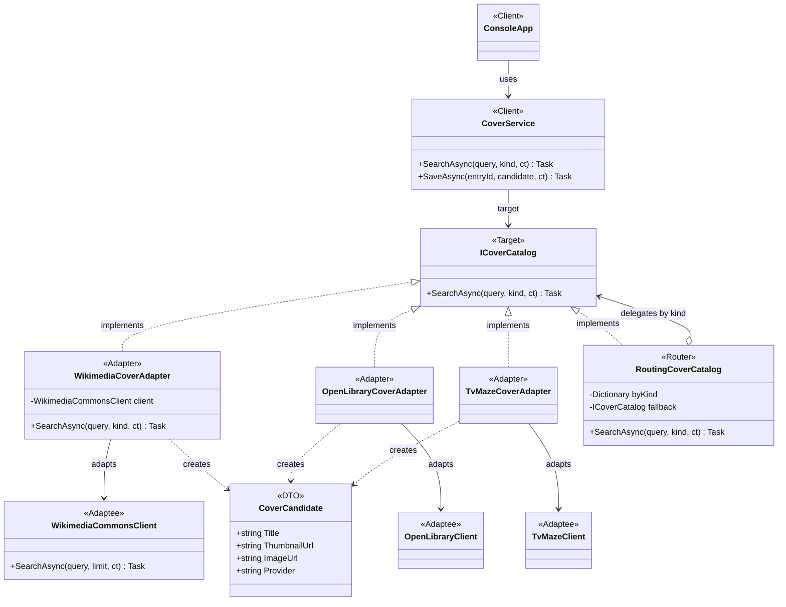
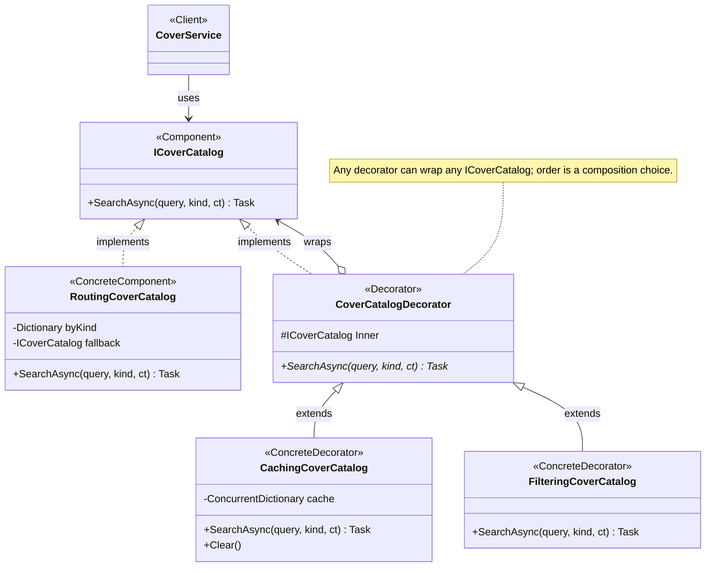
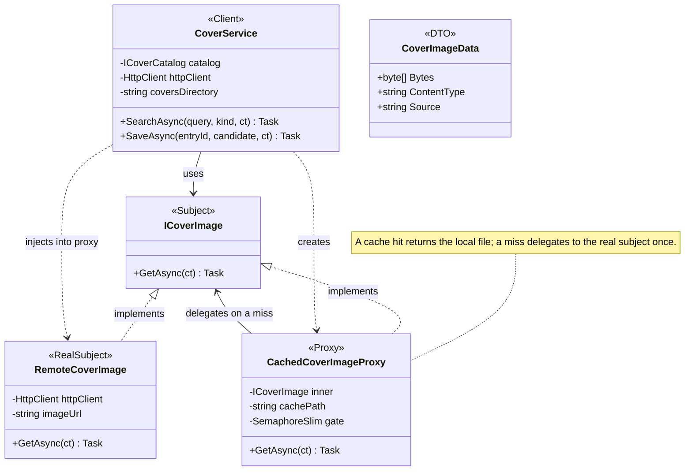

# Lab 2 Report — Structural Design Patterns

**Course:** Tehnici și Mecanisme de Proiectare Software (TMPS)  
**Author:** Dinu Pleșu, FAF241  
**Technology:** C# / .NET 10 console  
**Year:** 2026  
**Instructor:** Istrati Daniel

---

## Objectives

1. Study and understand the Structural Design Patterns.
2. As a continuation of the previous laboratory work, think about the
   functionalities that the system will need to provide to the user.
3. Implement some additional functionalities, or create a new project, using
   structural design patterns.

## Main tasks

By extending the project, implement at least 3 structural design patterns:

- the implemented patterns should help perform the tasks the system offers;
- the object creation mechanisms/patterns can now be buried inside the
  functionalities instead of being used in the client;
- there should be only one client for the whole system.

## Theory

Structural patterns describe how classes and objects are composed into larger
structures while keeping those structures flexible. Class-level structural
patterns rely on inheritance; object-level ones rely on composition, which can
be rearranged at runtime. The common ones are Adapter, Bridge, Composite,
Decorator, Facade, Flyweight and Proxy.

This lab uses three of them, all on the same cover workflow:

- **Adapter** converts an interface the project does not own into the one the
  client expects.
- **Decorator** wraps an object in another object with the same interface to
  add behavior without changing the original class.
- **Proxy** stands in for an expensive or remote object with the same
  interface and controls access to it (caching, validation, lazy loading).

---

## 1. Domain description

The application is a **local consumed-media watchlist**. A user adds films,
shows, books, games, anime or manga, gives them a category, tags, progress and
notes, marks them consumed, rates them from 1 to 10, and finds a cover online.

Unlike the earlier labs, the library is stored as a **Markdown vault**, not
JSON:

```text
library/
  index.md
  entries/0001-the-matrix.md
  covers/0001.jpg
```

One entry is one file with frontmatter and a notes body:

```md
---
id: 1
title: The Matrix
kind: film
category: Sci-Fi
tags: [action, classic]
status: rated
rating: 9
progress: 1/1
cover: covers/0001.jpg
---
# The Matrix

Watched on a rainy night.
```

The folder is useful without the app: `index.md` is a generated overview, the
entry files are readable/editable in any editor or Obsidian, and covers are
normal image files. The app preserves unknown frontmatter keys and the notes
body, reports malformed files instead of overwriting them, and writes
atomically.

## 2. Project structure

```text
Lab2/
├── Core/                           Watchlist.Core (shared with Lab 3)
│   ├── Domain/
│   │   ├── MediaItem.cs            state + rating rules
│   │   ├── MediaKind.cs
│   │   ├── MediaStatus.cs
│   │   └── MediaItemBuilder.cs     reused Builder
│   ├── Storage/
│   │   ├── MarkdownWatchlistStore.cs
│   │   ├── MarkdownEntryCodec.cs
│   │   ├── VaultIndexWriter.cs
│   │   ├── VaultMigrator.cs      copy between storage locations
│   │   ├── WatchlistRepository.cs
│   │   └── WatchlistStoreFactory.cs reused Factory Method
│   └── CoverSearch/
│       ├── CoverCandidate.cs
│       ├── ICoverCatalog.cs        target interface
│       ├── RoutingCoverCatalog.cs
│       ├── CoverService.cs
│       ├── CoverServiceFactory.cs  assembles the pipeline
│       ├── Providers/              third-party API clients
│       ├── Adapters/               Adapter pattern
│       ├── Decorators/             Decorator pattern
│       └── Images/                 Proxy pattern
└── Console/                        Lab 2 client
    ├── Program.cs
    ├── Lab2Composition.cs
    └── ConsoleApp.cs
```

The console client depends on `CoverService`, `IWatchlistStore` and
`WatchlistRepository`; it never constructs a provider, adapter, decorator or
file format itself. Object creation is buried in Core, as the task asks:

- `MarkdownWatchlistStoreFactory` (Factory Method) creates the store;
- `CoverServiceFactory` builds the provider clients, the three adapters, the
  routing table and the decorator chain, and returns a ready `CoverService`.

`Lab2Composition` is a few lines that call those two factories, and Lab 3 calls
the same `CoverServiceFactory`, so the pipeline is defined once.

```csharp
public static ICoverCatalog CreateCatalog(HttpClient http)
{
    var wikimedia = new WikimediaCoverAdapter(new WikimediaCommonsClient(http));
    var openLibrary = new OpenLibraryCoverAdapter(new OpenLibraryClient(http));
    var tvMaze = new TvMazeCoverAdapter(new TvMazeClient(http));

    var routing = new RoutingCoverCatalog(
        new Dictionary<MediaKind, ICoverCatalog>
        {
            [MediaKind.Book] = openLibrary,
            [MediaKind.Manga] = openLibrary,
            [MediaKind.Series] = tvMaze,
            [MediaKind.Anime] = tvMaze,
            [MediaKind.Film] = wikimedia,
            [MediaKind.Game] = wikimedia,
        },
        wikimedia);

    return new FilteringCoverCatalog(new CachingCoverCatalog(routing));
}
```

## 3. Adapter

The Mermaid diagrams follow the Refactoring Guru structure: the role is the
stereotype in the box, and the box title is the real project class.

### Intent and the real problem

`ICoverCatalog` is the app's target interface:

```csharp
public interface ICoverCatalog
{
    Task<IReadOnlyList<CoverCandidate>> SearchAsync(
        string query, MediaKind kind, CancellationToken ct = default);
}
```

Three public services answer with completely different shapes:

- Wikimedia Commons returns nested `query.pages[].imageinfo[]` with
  `thumburl`, `url` and `mime`;
- Open Library returns `docs[]` with `cover_i` and `author_name`;
- TVmaze returns `[] { show: { name, image: { medium, original } } }`.

The adaptees are public APIs the project does not own, so this is a real
Adapter, not a wrapper around our own class. Each client models the foreign
response; each adapter translates it to `CoverCandidate`. Adding a new provider
means adding a client and an adapter only.



### Code where the pattern is visible

[`Lab2/Core/CoverSearch/Adapters/WikimediaCoverAdapter.cs`](../Lab2/Core/CoverSearch/Adapters/WikimediaCoverAdapter.cs)

```csharp
public async Task<IReadOnlyList<CoverCandidate>> SearchAsync(
    string query, MediaKind kind, CancellationToken cancellationToken = default)
{
    if (string.IsNullOrWhiteSpace(query))
    {
        return [];
    }

    var images = await client.SearchAsync(query, cancellationToken: cancellationToken);
    return images
        .Where(image => image.MimeType.StartsWith("image/", StringComparison.OrdinalIgnoreCase))
        .Where(image => !image.MimeType.Contains("svg", StringComparison.OrdinalIgnoreCase))
        .Select(image => new CoverCandidate(
            CleanTitle(image.Title),
            image.ThumbnailUrl,
            image.ImageUrl,
            "Wikimedia Commons"))
        .ToArray();
}
```

The adapter is the only code that knows Wikimedia's `File:` prefix and MIME
field. The rest of the application only sees `CoverCandidate`.

### Tests

| Test | What it proves |
|---|---|
| `Wikimedia_adapter_maps_foreign_response_to_cover_candidates` | A foreign JSON payload becomes candidates with a cleaned title, thumbnail, original URL and provider; SVG is rejected. |
| `OpenLibrary_adapter_skips_books_without_a_cover_id` | Books without `cover_i` are omitted instead of producing a broken link; author and cover URLs are mapped. |

## 4. Decorator

### Intent and the real problem

Search results need two independent behaviors: do not ask the same provider
twice, and never hand unusable links to the UI. Both must work in any order and
must not change `ICoverCatalog` for the client.

`CoverCatalogDecorator` is the common base; `CachingCoverCatalog` and
`FilteringCoverCatalog` are the concrete decorators. `RoutingCoverCatalog`
(which selects a provider by media kind) is the component they can wrap.



### Code where the pattern is visible

[`Lab2/Core/CoverSearch/Decorators/FilteringCoverCatalog.cs`](../Lab2/Core/CoverSearch/Decorators/FilteringCoverCatalog.cs)

```csharp
public override async Task<IReadOnlyList<CoverCandidate>> SearchAsync(
    string query, MediaKind kind, CancellationToken cancellationToken = default)
{
    var hits = await Inner.SearchAsync(query, kind, cancellationToken);
    var seen = new HashSet<string>(StringComparer.OrdinalIgnoreCase);

    return hits
        .Where(hit => !string.IsNullOrWhiteSpace(hit.Title))
        .Where(hit => IsHttpUrl(hit.ImageUrl))
        .Where(hit => !BlockedExtensions.Any(extension =>
            Uri.TryCreate(hit.ImageUrl, UriKind.Absolute, out var uri) &&
            uri.AbsolutePath.EndsWith(extension, StringComparison.OrdinalIgnoreCase)))
        .Where(hit => seen.Add(hit.ImageUrl))
        .Take(20)
        .ToArray();
}
```

The decorator calls the wrapped catalog and adds behavior before returning.
The caching decorator does the same with a key of kind + normalized query. The
composition in `Lab2Composition` is:

```csharp
ICoverCatalog catalog = new FilteringCoverCatalog(new CachingCoverCatalog(routing));
```

Stacking them in the other order is also valid; both still implement
`ICoverCatalog`.

### Tests

| Test | What it proves |
|---|---|
| `Caching_decorator_avoids_a_second_provider_call` | The second identical search returns the cached result; the inner catalog is called once. |
| `Filtering_decorator_removes_invalid_duplicate_and_svg_hits` | Bad schemes, relative URLs, empty titles, duplicate image URLs and blocked formats are removed. |
| `Decorators_can_be_stacked_in_either_order` | Filtering/caching in both orders produce the same usable result. |

## 5. Proxy

### Intent and the real problem

Downloading a cover is slow and must not happen twice. The UI wants to say
`ICoverImage.GetAsync()`, but the app needs a local cache, a size limit, a
content check and protection against two concurrent card renders downloading
the same file.

`RemoteCoverImage` is the real subject. `CachedCoverImageProxy` has the same
interface, owns the local file and delegates only on a miss. `CoverService`
creates the proxy; the client never downloads directly.



### Code where the pattern is visible

[`Lab2/Core/CoverSearch/Images/CachedCoverImageProxy.cs`](../Lab2/Core/CoverSearch/Images/CachedCoverImageProxy.cs)

```csharp
public async Task<CoverImageData> GetAsync(CancellationToken cancellationToken = default)
{
    await _gate.WaitAsync(cancellationToken);
    try
    {
        if (File.Exists(cachePath))
        {
            var cached = await File.ReadAllBytesAsync(cachePath, cancellationToken);
            if (cached.Length > 0 && cached.Length <= maxBytes)
            {
                return new CoverImageData(
                    cached, CoverImageTypes.ContentTypeForPath(cachePath), cachePath);
            }

            File.Delete(cachePath);
        }

        var downloaded = await inner.GetAsync(cancellationToken);
        if (downloaded.Bytes.Length == 0 || downloaded.Bytes.Length > maxBytes)
        {
            throw new CoverImageException("The downloaded cover has an invalid size.");
        }

        // ... validate bytes, write temp file, atomically move to cachePath ...
        return new CoverImageData(downloaded.Bytes, downloaded.ContentType, cachePath);
    }
    finally
    {
        _gate.Release();
    }
}
```

The proxy keeps `ICoverImage` unchanged, enforces a 12 MB limit, recognises
real image signatures, and serializes concurrent requests for one file. A
second selection of the same cover reads the file instead of downloading it
again. `CoverService` saves the provider thumbnail locally (the original URL
stays in `coverSource`), which keeps the vault small.

### Tests

| Test | What it proves |
|---|---|
| `Proxy_downloads_once_then_serves_the_cached_file` | The first call downloads and writes; the second reads the cache; the real subject is called once. |
| `Proxy_rejects_a_payload_that_is_not_an_image` | Non-image bytes are rejected and no cache file is left behind. |
| `Proxy_serializes_concurrent_requests_for_the_same_cover` | Two simultaneous requests result in one download. |
| `Cover_service_uses_the_proxy_cache_for_a_second_save` | The service path uses the proxy cache. |
| `Cover_service_downloads_the_provider_thumbnail_for_the_local_card` | The local card uses the thumbnail URL, not the huge original. |

## 6. How the patterns interact

The cover workflow is one execution path through Adapter, Decorator and Proxy:

```text
ConsoleApp
  -> ICoverCatalog (FilteringCoverCatalog)      Decorator
  -> ICoverCatalog (CachingCoverCatalog)        Decorator
  -> RoutingCoverCatalog
  -> WikimediaCoverAdapter                      Adapter
  -> WikimediaCommonsClient -> public API
  -> CoverService
  -> ICoverImage (CachedCoverImageProxy)        Proxy
  -> ICoverImage (RemoteCoverImage)             real subject
  -> covers/<id>.jpg
```

The console's `patterns` command prints the same chain. This is not three
isolated demos in `main()`: the normal `search` command goes through all three
patterns and then writes the result into the Markdown entry.

`CoverServiceFactory` builds this chain, and two tests check the assembled
pipeline rather than each class alone:

| Test | What it proves |
|---|---|
| `Factory_pipeline_routes_by_kind_filters_and_caches` | An anime search is routed to the TVmaze adapter, the duplicate image is filtered out, and the repeated search is answered from the cache (one HTTP call). |
| `Factory_pipeline_falls_back_to_wikimedia_when_the_book_source_is_empty` | When Open Library returns nothing for a book, routing falls back to the Wikimedia adapter. |

## 7. Reuse from Lab 1

- **Builder:** `MediaItemBuilder` assembles a valid entry (title, kind,
  category, tags, status, cover, source, timestamps) step by step.
- **Factory Method:** `WatchlistStoreFactory` declares creation of the store;
  `MarkdownWatchlistStoreFactory` supplies the Markdown implementation.
  Changing storage is a new factory, not an edit in the console.

`CoverServiceFactory` follows the same idea for the structural pipeline: the
client asks for a `CoverService` and the factory decides which adapters and
decorators exist and in which order. The client depends on abstractions only.

## 8. Runnable demo

The full transcript is reproducible with `dotnet run --project
.\Lab2\Console\Lab2.csproj`, a temporary `TMPS_LAB2_LIBRARY`, and the commands
from `Lab2/README.md`. Excerpt from the verified run (26 Nov 2026), where a
book search is routed to the Open Library adapter:

```text
Consumed Media Watchlist — Lab 2 (structural patterns)
Vault: C:\Users\...\lab2-demo-vault
The library is plain Markdown; open index.md without this app.

watchlist> search
Entry id: 2
Search covers for [Dune]:
Searching through the decorated catalog...
  [1] Dune — Frank Herbert
      Open Library · https://covers.openlibrary.org/b/id/11481354-L.jpg
  ...
Pick a cover number (blank cancels): 1
Downloading through the image proxy...
Saved covers/0002.jpg (21.9 KB).

watchlist> list
ID   Status           Title                              Kind     Category         Cover Tags
1    rated 9/10       The Matrix                         Film     Sci-Fi           -     action, classic
2    planned          Dune                               Book     Sci-Fi           yes   space opera
```

The vault after the run:

```text
index.md                          549 bytes
entries/0001-the-matrix.md        248 bytes
entries/0002-dune.md              272 bytes
covers/0002.jpg                  ~22 KB
```

`index.md` groups entries by status and links each entry file and cover; the
Dune entry now has `cover: covers/0002.jpg` and the original Open Library URL
as `coverSource`.

## 9. Tests and evidence

Command:

```powershell
dotnet test .\Tests\Watchlist.Tests\Watchlist.Tests.csproj
```

Result from the verified run:

```text
Passed!  - Failed:     0, Passed:    51, Skipped:     0, Total:    51, Duration: 142 ms
```

The 51 tests include the Markdown vault (codec, unknown keys, malformed files,
index, repository, migration), the three cover patterns, the assembled
factory pipeline and the Lab 3 behavioral tests in the same test project. Test
names are listed in sections 3–6 for the structural patterns; the project
compiles with:

```text
Watchlist.Core -> ...\Watchlist.Core.dll
Lab2 -> ...\Lab2.dll
Build succeeded. 0 Warning(s) 0 Error(s)
```

## 10. Requirements checklist

| Requirement | Where it is met |
|---|---|
| At least 3 structural patterns | Adapter (§3), Decorator (§4), Proxy (§5) |
| Patterns perform real tasks of the system | The `search`/`cover` commands find, filter, cache and save a cover through all three (§6) |
| Creation buried inside the functionalities | `MarkdownWatchlistStoreFactory`, `CoverServiceFactory` and `MediaItemBuilder` live in Core; the client only receives a `CoverService` and a repository (§2, §7) |
| One client for the whole system | `Lab2/Console` is the only client of Lab 2 |
| Modules separated by responsibility | `Domain`, `Storage`, `CoverSearch` (`Providers`, `Adapters`, `Decorators`, `Images`) and `Console` (§2) |
| Git hosting, README and report | This repository, `Lab2/README.md` and this report |

## 11. Conclusions

The hard part was not the pattern structure but the trust boundary around a
human-editable vault. The codec had to round-trip quotes, commas, Unicode,
unknown keys and notes without losing data; the tests now pin those cases. The
Markdown storage also made the Adapter/Decorator/Proxy path easy to demonstrate
because a selected cover is immediately a normal file the user can inspect.

I would change two things next. First, a real film provider with an API key
(TMDB/OMDb) would produce better posters than Wikimedia's file search; the
current Adapter interface makes that a new adapter only. Second, the console
downloads the provider thumbnail but does not offer a choice between thumbnail
and original; a quality selector would be a small addition to `CoverService`.
