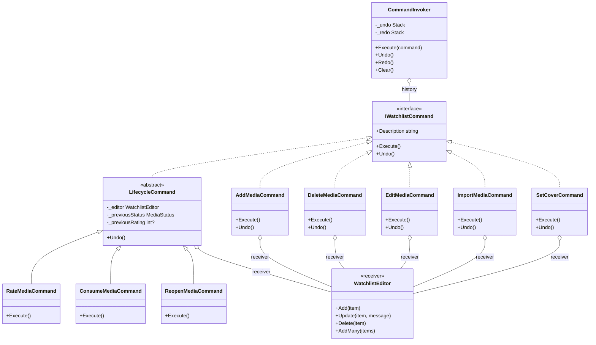
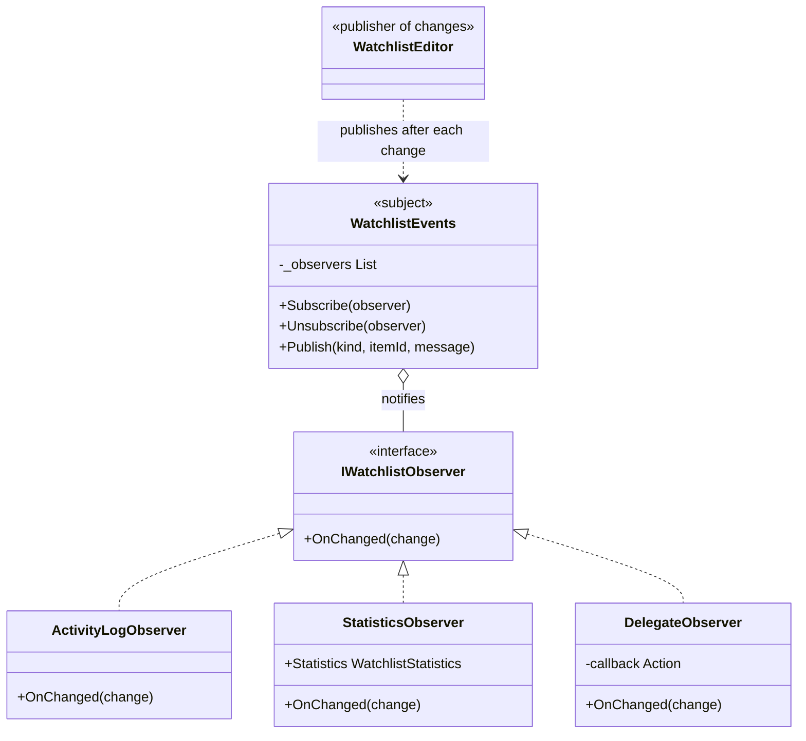
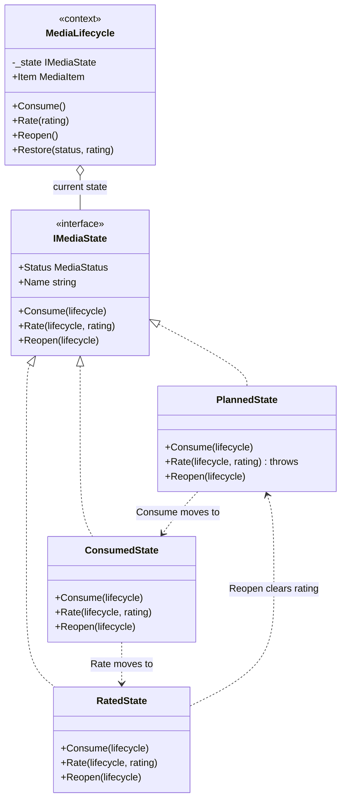
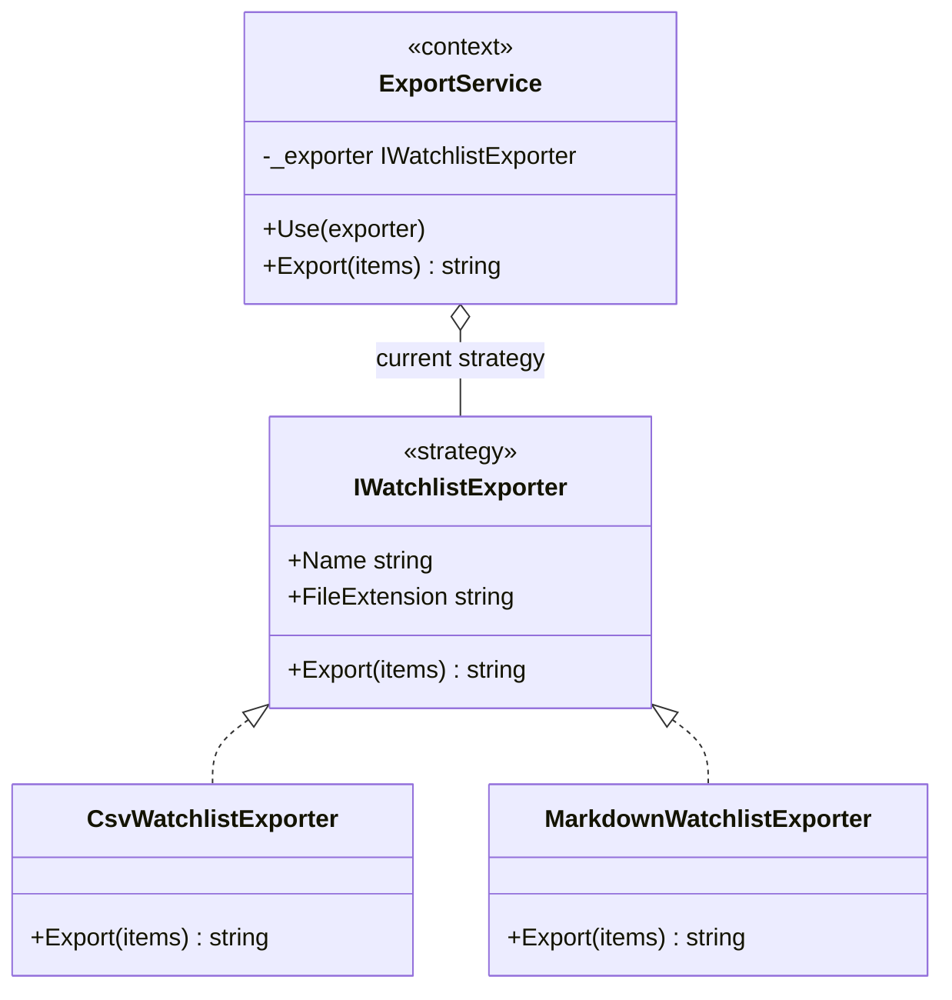

# Lab 3 Report — Behavioral Design Patterns

**Course:** TMPS · **Author:** Pleșu Dinu (FAF241) · **Technology:** C# / .NET 10, MAUI Android client
**Package:** `net.plesu.dinu.shameless.watchlist`
**Repository:** `Lab3/Behavioral` (pattern library), `Lab3/App` (Android client), `Lab2/Core` (shared from Lab 2), `Tests/Watchlist.Tests`

## Objectives

- Explain the intent of each behavioral pattern and how it distributes responsibilities and communication between objects.
- Recognise where a behavioral pattern fits naturally in a codebase, and where it would be forced.
- Implement the patterns so behavior can be changed or extended without modifying existing classes.
- Show that objects communicate through abstractions rather than hard-coded dependencies.
- Defend design choices and adapt the code to a new requirement during the defence.

## Task

Implement **at least three** behavioral patterns in one project, and learn the rest that were not implemented. Interpreter is good to know but does not count as one of the three.

Implemented here: **Command** (with undo and redo), **Observer**, **State**, and **Strategy** (a fourth one, used for export). Not implemented: Chain of Responsibility, Interpreter, Iterator, Mediator, Memento, Template Method, Visitor. Their intent and where they would fit are in §11.

## Theory

Behavioral patterns describe how objects share responsibilities and communicate.

- **Command** turns a request into an object, so it can be queued, logged, executed again or undone.
- **Observer** lets dependent objects be notified automatically when a subject changes, without the subject knowing their concrete types.
- **State** changes an object's behavior when its internal state changes. Each state is a class, and transitions live in those classes.
- **Strategy** defines a family of interchangeable algorithms behind one interface and lets the client pick one at run time.

## 1. Domain description

The application is a personal **watchlist** of films, series, anime, manga, books and games. Each entry has a title, kind, category, tags, status (Planned, Consumed, Rated), an optional rating (1–10), notes, and a cover. The user adds, edits, consumes, rates, reopens, deletes, imports, exports and undoes changes. Entries are stored as Markdown in a local vault, the same vault format as Lab 2.

## 2. Build on Lab 2

The sheet asks to reuse at least one creational or structural pattern from an earlier lab. This project reuses the **Lab 2** Core:

- `WatchlistRepository` and `MarkdownWatchlistStore` (the vault) are the receiver's storage. `WatchlistEditor` calls them and never touches files directly.
- `MediaItemBuilder` (Builder from Lab 1) creates entries for `AddMediaCommand` and for imports.
- `CoverService` (Adapter, Decorator and Proxy from Lab 2) provides the cover for `SetCoverCommand`.

The behavioral layer adds to Lab 2 and does not change its classes.

## 3. Project structure

```text
Lab3/
├── Behavioral/                       pattern library, no UI code
│   ├── Commands/                     Command: IWatchlistCommand, CommandInvoker, concrete commands, WatchlistEditor (receiver)
│   ├── Observers/                    Observer: IWatchlistObserver, WatchlistEvents (subject), observers
│   ├── States/                       State: MediaLifecycle (context), IMediaState, Planned/Consumed/RatedState
│   ├── Export/                       Strategy: ExportService (context), IWatchlistExporter, CSV and Markdown
│   └── Import/                       AniList, MAL XML and CSV importers, ImportService
├── App/                              .NET MAUI Android client
│   ├── AppServices.cs                builds the graph and subscribes the observers
│   ├── MainPage, EditPage, ImportPage, CoverPickerPage, SettingsPage, ActivityPage, StorageSetupPage
Tests/Watchlist.Tests/                CommandTests, ObserverTests, StateTests, ExportTests, ImportTests
```

## 4. Command

### Intent and the real problem

The user's actions (add, edit, consume, rate, reopen, delete, import, set a cover) must be undoable and redoable in the same order they were done. If each screen called the repository directly, undo would need a special case per action. A **command** object describes one action, knows how to run it and how to reverse it, and an invoker keeps the history.

### Class diagram



### Code where the pattern is visible

[`Lab3/Behavioral/Commands/CommandInvoker.cs`](Lab3/Behavioral/Commands/CommandInvoker.cs):

```csharp
public sealed class CommandInvoker
{
    private readonly Stack<IWatchlistCommand> _undo = [];
    private readonly Stack<IWatchlistCommand> _redo = [];

    public void Execute(IWatchlistCommand command)
    {
        command.Execute();
        _undo.Push(command);
        _redo.Clear();
        HistoryChanged?.Invoke(this, EventArgs.Empty);
    }

    public void Undo()
    {
        if (!_undo.TryPeek(out var command)) return;
        command.Undo();
        _undo.Pop();
        _redo.Push(command);
        HistoryChanged?.Invoke(this, EventArgs.Empty);
    }
}
```

Only a command that executed successfully enters the history. A new command clears the redo stack. `LifecycleCommand` stores the status and rating before it runs, so undo restores the exact previous values instead of guessing a reverse transition.

### Tests

- `Add_command_undo_removes_and_redo_restores`: undo removes the added entry, redo restores it.
- `Delete_command_undo_restores_the_exact_entry`: undo brings back the same entry with the same id.
- `Edit_command_undo_restores_previous_values`: undo restores the previous title, notes and tags.
- `Consume_undo_returns_to_planned` and `Rate_undo_returns_to_consumed_without_rating`: undo restores the exact previous status and rating.
- `New_command_clears_the_redo_stack`: after undo, a new command removes the redo history.
- `Import_command_undo_removes_every_imported_entry`: one undo removes a whole import.

## 5. Observer

### Intent and the real problem

After any change, the activity feed, the statistics counters and the list must update. If the editor called each of them directly, adding a new view would mean editing the editor. An **observer** subscribes to a subject and is notified of each change. The subject does not know the concrete observers.

### Class diagram



### Code where the pattern is visible

[`Lab3/Behavioral/Observers/WatchlistEvents.cs`](Lab3/Behavioral/Observers/WatchlistEvents.cs), abridged:

```csharp
public void Publish(WatchlistChangeKind kind, int? itemId, string message)
{
    var change = new WatchlistChange(kind, itemId, message, DateTimeOffset.Now);
    IWatchlistObserver[] snapshot;
    lock (_gate)
    {
        if (_publishing) throw new InvalidOperationException("Observers must not publish another change.");
        _publishing = true;
        snapshot = _observers.ToArray();
    }

    try
    {
        foreach (var observer in snapshot)
        {
            try { observer.OnChanged(change); }
            catch (Exception ex) { ObserverFailed?.Invoke(this, ex); }
        }
    }
    finally
    {
        lock (_gate) { _publishing = false; }
    }
}
```

The subject notifies a snapshot, so an observer may unsubscribe while being notified. A failing observer is reported and does not block the save or the other observers. A nested publish is refused, so the observers cannot loop.

### Tests

- `All_subscribers_are_notified_and_unsubscribed_ones_are_not`: subscribed observers receive the change, unsubscribed ones do not.
- `Statistics_observer_recomputes_counts_and_average`: the counters match the library after a change.
- `Activity_log_keeps_the_latest_entries`: the log keeps the newest 50 entries.
- `A_failing_observer_does_not_block_the_change_or_other_observers`: one observer throws, the others still run.
- `An_observer_cannot_publish_a_nested_change`: a nested publish is refused.

## 6. State

### Intent and the real problem

An entry is Planned, Consumed or Rated, and each status allows different actions: a Planned entry cannot be rated, a Rated entry can be reopened, and so on. Written as `switch` statements on a status enum, these rules would be spread through the commands and the UI. The **State** pattern puts each status in its own class, and the context delegates each action to the current state.

### Class diagram



### Code where the pattern is visible

[`Lab3/Behavioral/States/PlannedState.cs`](Lab3/Behavioral/States/PlannedState.cs):

```csharp
public sealed class PlannedState : IMediaState
{
    public MediaStatus Status => MediaStatus.Planned;
    public string Name => "Planned";

    public void Consume(MediaLifecycle lifecycle)
    {
        lifecycle.Item.MarkConsumed();
        lifecycle.MoveTo(new ConsumedState());
    }

    public void Rate(MediaLifecycle lifecycle, int rating) =>
        throw new InvalidOperationException("Mark the media as consumed before rating it.");
}
```

The rule "a planned entry cannot be rated" is written once, in `PlannedState`. The commands call `MediaLifecycle` and never inspect the status.

### Tests

- `Planned_rejects_rating`: rating a Planned entry throws.
- `Consume_moves_to_consumed_and_rate_moves_to_rated`: the two valid transitions.
- `Reopen_from_rated_clears_the_rating_and_returns_to_planned`: reopen clears the rating.
- `Restore_rejects_an_inconsistent_snapshot`: a restore with a rating on a Planned entry is refused.
- `Lifecycle_state_is_visible_through_the_context` (in `CommandTests`): the state name follows the transitions.

## 7. Strategy (fourth pattern)

### Intent and the real problem

The user can export the watchlist as CSV or as Markdown. The export code should not contain both formats in one class, and the choice should change at run time without restarting the app.

### Class diagram



### Code where the pattern is visible

[`Lab3/Behavioral/Export/ExportService.cs`](Lab3/Behavioral/Export/ExportService.cs):

```csharp
public sealed class ExportService(IWatchlistExporter initial)
{
    private IWatchlistExporter _exporter = initial;

    public void Use(IWatchlistExporter exporter) => _exporter = exporter;

    public string Export(IReadOnlyCollection<MediaItem> items) => _exporter.Export(items);
}
```

The import side has the same shape: `IWatchlistImporter` is implemented by AniList, MAL XML and CSV, and `ImportService` never names a format.

### Tests

- `Export_service_switches_strategy_at_runtime`: the same service exports CSV, then Markdown, after `Use`.
- `Csv_escapes_commas_quotes_and_newlines` and `Markdown_export_contains_the_entry_and_its_notes`: each strategy keeps its own format rules.

## 8. Pattern interaction and runtime behavior

The sheet requires at least one execution path through two or more patterns, and at least one pattern that changes behavior at run time. Both are met by the **Rate** action:

```text
User taps "Rate 8/10" on a card
  client → CommandInvoker.Execute(RateMediaCommand)          (Command)
    → RateMediaCommand.Execute()
      → MediaLifecycle.Rate(8)                               (State context)
        → ConsumedState.Rate → RatedState                    (State transition)
      → WatchlistEditor.Update(item, "Rated … 8/10.")        (receiver)
        → repository.Update(item) → Markdown vault
        → WatchlistEvents.Publish(Updated, …)                (Observer subject)
          → ActivityLogObserver.OnChanged                   (feed updated)
          → StatisticsObserver.OnChanged                    (counters updated)
          → list refresh observer                           (UI updated)
```

Run-time behavior changes in three places, without recompiling:

- **Command:** Undo and Redo change the library state at run time.
- **State:** the same "Rate" call does different things depending on the entry's current status, and an illegal call is refused.
- **Strategy:** the export format is swapped with `ExportService.Use` while the app runs.
- **Observer:** `MainPage` subscribes its statistics and refresh observers at run time, and `WatchlistEvents` lets any observer unsubscribe while the app runs.

## 9. Import and export

| Source | Format | Notes |
|---|---|---|
| AniList | GraphQL JSON | status, score, format, cover URL mapped to `MediaItem` |
| MyAnimeList | XML export | anime and manga rows, invalid XML reported |
| Generic | CSV | quoted fields, optional columns, a title column is required |

Duplicates are detected by normalised title and kind before import. An import is one undoable command, and its progress is reported one entry at a time (`ImportProgress`). Export produces CSV or Markdown through `ExportService`.

## 10. Library location and permissions

Lab 3 is local-first, but on Android the app-private storage is not easy to browse in the Files app. The first launch therefore shows `StorageSetupPage`:

- **Shared Documents**: `/storage/emulated/0/Documents/TMPS-Watchlist`. On Android 11+ the page checks `Environment.IsExternalStorageManager`. If it is not granted, the button opens the system "All files access" settings for the package. Once granted, the app creates the folder, copies any existing app-private entries and covers with `VaultMigrator` (without overwriting target files), and stores the path in `Preferences`.
- **App storage**: `FileSystem.AppDataDirectory/library`. No permission is needed, but the folder is not visible in Files. Export and share remain available.

On later launches the saved path is reused. If the folder is missing or the permission was revoked, the setup page appears again. `TMPS_LAB3_LIBRARY` overrides the path for desktop and tests.

The shared option uses `MANAGE_EXTERNAL_STORAGE`, which suits a sideloaded lab APK but is restricted by Google Play policy. The production alternative is the Storage Access Framework folder picker. The physical-file store keeps the Markdown vault simple and compatible with Lab 2.


## 11. Patterns not implemented

- **Chain of Responsibility.** Would pass a request along handlers until one handles it. The import pipeline could be a chain (AniList, then MAL, then CSV), but the current design picks the importer by the user's choice, so the chain would be forced.
- **Interpreter** (good to know, not counted). Would evaluate a small query language such as `status:consumed rating>7`. The search box uses plain text matching, so the pattern is not present.
- **Iterator.** Would traverse the library without exposing the list. The app iterates the list directly with LINQ, which is enough here.
- **Mediator.** Would route communication between UI components through one object. `WatchlistEvents` is close, but it only broadcasts changes and does not let components talk to each other, so the report does not claim the pattern.
- **Memento.** Would capture and restore state without breaking encapsulation. `LifecycleCommand` and `SetCoverCommand` store the previous values, which is a memento in spirit, but the snapshot is not a separate class.
- **Template Method.** Would define an algorithm skeleton in a base class. The importers share no steps, so the pattern would be forced.
- **Visitor.** Would add operations to the entry types without changing them. The entry types are stable, so the pattern is not needed.

## 12. Tests and evidence

Command (run from the repository root):

```powershell
dotnet test Tests/Watchlist.Tests/Watchlist.Tests.csproj
```

Result on this repository: `Passed! - Failed: 0, Passed: 55, Skipped: 0, Total: 55`. Test files: `CommandTests` (9), `ObserverTests` (5), `StateTests` (4), `ExportTests` (3), `ImportTests` and `CsvImportTests` (the rest), and the Lab 2 `CoverPatternTests`.

Runtime evidence on the `Medium_Phone_API_37` emulator is in §13.

The main library screen on the emulator, with the bottom tabs and the Command, Observer, State and Strategy footer:


## 13. Build evidence

```powershell
$env:JAVA_HOME = "C:\path\to\jdk-21"
$env:ANDROID_HOME = "$env:LOCALAPPDATA\Android\Sdk"
dotnet publish .\Lab3\App\Lab3.csproj -c Release -f net10.0-android -p:AndroidKeyStore=false
```

The build requires JDK 21 specifically; JDK 25 is rejected by the Android SDK tooling (`XA0030`). The repository's `build-all-labs.yml` workflow installs the MAUI Android workload and JDK 21 and builds the Lab 1, 2 and 3 APKs on every push. Tags `v*` and `labs-v*` also publish a GitHub Release with every APK attached.

APK produced by CI and by the local publish: `net.plesu.dinu.shameless.watchlist-Signed.apk`.

## 14. Requirements checklist

| Requirement | Status |
|---|---|
| At least 3 behavioral patterns, full structure | Command (invoker, command, receiver), Observer (subject, observer), State (context, state, 3 concrete states), Strategy (context, strategy, 2 concrete) |
| Patterns interact (one path through 2+ patterns) | Yes, §8 Rate path (Command, State, Observer) |
| Client code depends on abstractions | Yes, `IWatchlistCommand`, `IWatchlistObserver`, `IMediaState`, `IWatchlistExporter` |
| Open for extension | Yes: a new strategy, command, state or observer is a new class |
| Build on Lab 2 | Yes, §2 (repository, Builder, cover pipeline) |
| Clean project structure | Yes, §3 |
| Runnable demo with readable output | Android app on the emulator (§13 and the screenshots in the repository) |
| Behavior changes at runtime | Yes, §8 (undo and redo, state transitions, export strategy, observers) |
| 2+ unit tests per pattern | Yes, §4–§7 |
| UML class diagram per pattern | Yes, §4–§7 (Mermaid) |
| Code snippet per pattern with explanation | Yes, §4–§7 |

## 15. Conclusions

- The hardest part was the undo of a lifecycle change. Storing the previous status and rating in the command was simpler than deriving the reverse transition, and it stays correct when a state rule changes.
- The observers had to be non-blocking. A failing or re-entrant observer must not break a save, so the subject takes a snapshot and refuses nested publishes.
- If I were designing it again, I would make the import pipeline a Chain of Responsibility from the start, so that a new source is a new handler and not a new `switch` branch.
