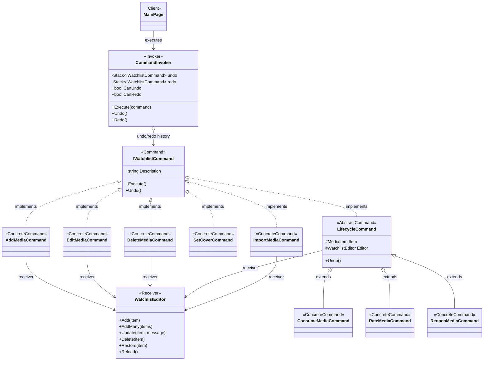
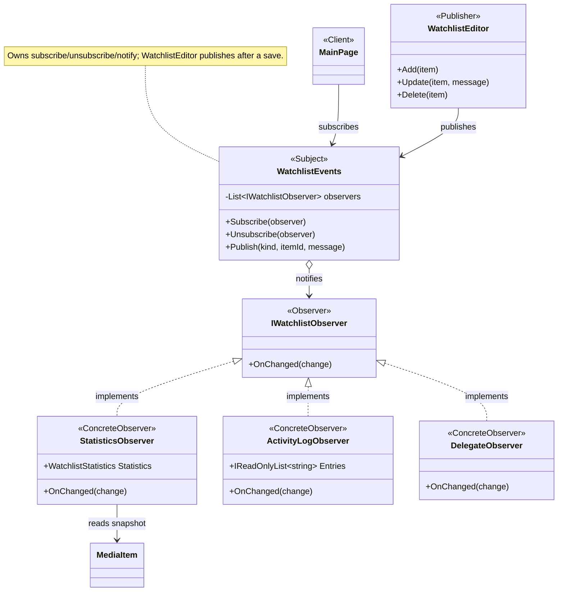
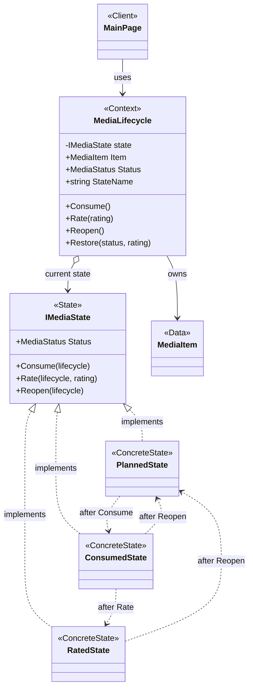
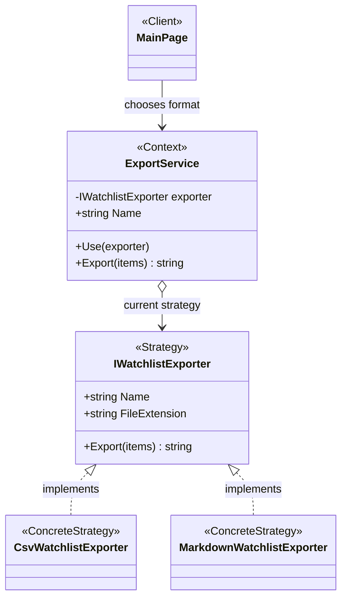
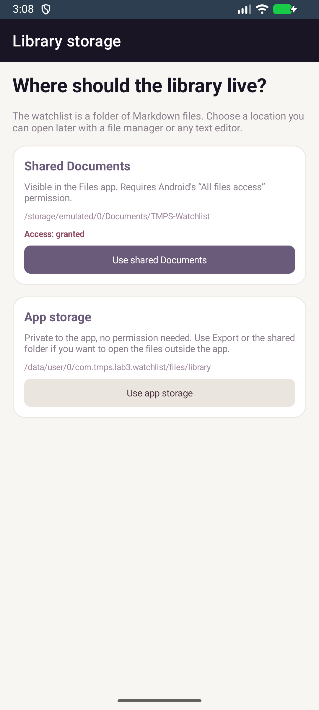
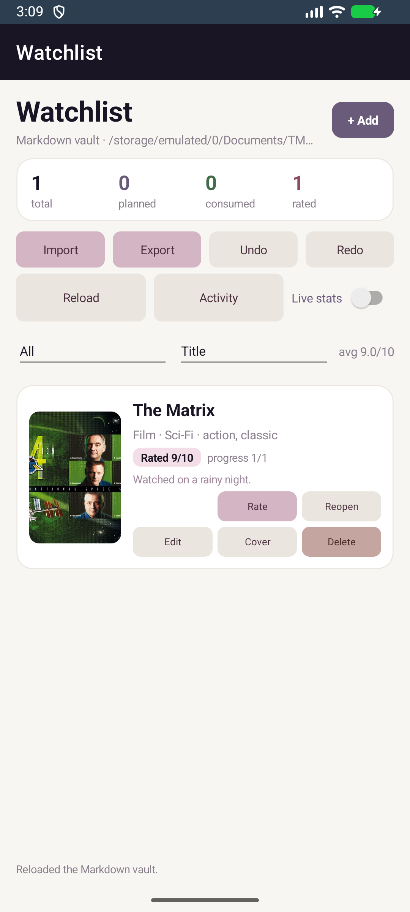

# Lab 3 Report — Behavioral Design Patterns

**Course:** Tehnici și Mecanisme de Proiectare Software (TMPS)  
**Author:** Dinu Pleșu, FAF241  
**Technology:** C# / .NET 10 MAUI (Android)  
**Year:** 2026  
**Instructor:** Istrati Daniel

---

## 1. Domain description

Lab 3 is the final watchlist application. It keeps the same media domain as
Lab 2 and reads/writes the same Markdown vault, but adds the interactive
behavior a real user expects: undo/redo, live counters, a guarded
planned → consumed → rated lifecycle, runtime filtering and export format
selection, a visual cover picker, and import from AniList or a MAL XML export.

The library remains portable. On first launch the user chooses a location:

```text
/storage/emulated/0/Documents/TMPS-Watchlist/   shared, visible in Files
  index.md
  entries/0001-the-matrix.md
  covers/0001.jpg
```

The no-permission fallback is `FileSystem.AppDataDirectory/library`. The shared
folder needs Android's “All files access” permission; it is the option that
makes the Markdown library readable in a normal file manager. Existing entries
are copied from app storage into the chosen folder without overwriting entries
that are already there.

The Android client is thin: all behavior lives in
`Lab3/Behavioral` (`net10.0`) and can be tested without an emulator. The MAUI
project references both that library and Lab 2's `Watchlist.Core`.

## 2. Build on Lab 2

Lab 3 literally references the Lab 2 core:

```text
Lab3/Behavioral/Watchlist.Behavioral.csproj
  -> ..\..\Lab2\Core\Watchlist.Core.csproj
Lab3/App/Lab3.csproj
  -> ..\Behavioral\Watchlist.Behavioral.csproj
  -> ..\..\Lab2\Core\Watchlist.Core.csproj
```

Reused from Lab 2:

- `MarkdownWatchlistStore`, `MarkdownEntryCodec`, `WatchlistRepository`;
- `VaultMigrator` for copying the existing vault into a new location;
- `MediaItem`, `MediaItemBuilder`;
- the structural cover pipeline: `ICoverCatalog`, provider adapters,
  filtering/caching decorators, `CachedCoverImageProxy`.

The cover picker in Lab 3 therefore uses exactly the same Adapter + Decorator +
Proxy path, and imported AniList/MAL covers can be displayed remotely or saved
locally through the same proxy.

## 3. Project structure

```text
Lab3/
├── Behavioral/                         Watchlist.Behavioral
│   ├── Commands/
│   │   ├── IWatchlistCommand.cs
│   │   ├── CommandInvoker.cs           undo/redo stacks
│   │   ├── WatchlistEditor.cs          receiver
│   │   ├── AddMediaCommand.cs
│   │   ├── EditMediaCommand.cs
│   │   ├── DeleteMediaCommand.cs
│   │   ├── LifecycleCommand.cs         previous-state snapshot
│   │   ├── ConsumeMediaCommand.cs
│   │   ├── RateMediaCommand.cs
│   │   ├── ReopenMediaCommand.cs
│   │   ├── SetCoverCommand.cs
│   │   └── ImportMediaCommand.cs
│   ├── Observers/
│   │   ├── WatchlistEvents.cs          subject
│   │   ├── IWatchlistObserver.cs
│   │   ├── StatisticsObserver.cs
│   │   ├── ActivityLogObserver.cs
│   │   └── DelegateObserver.cs
│   ├── States/
│   │   ├── MediaLifecycle.cs           context
│   │   ├── IMediaState.cs
│   │   ├── PlannedState.cs
│   │   ├── ConsumedState.cs
│   │   └── RatedState.cs
│   ├── Export/
│   │   ├── IWatchlistExporter.cs       strategy
│   │   ├── CsvWatchlistExporter.cs
│   │   ├── MarkdownWatchlistExporter.cs
│   │   └── ExportService.cs            context
│   └── Import/
│       ├── IWatchlistImporter.cs
│       ├── AniListImporter.cs
│       ├── MalXmlImporter.cs
│       └── ImportService.cs
└── App/                                .NET MAUI Android client
    ├── MainPage.xaml(.cs)              cards, stats, toolbar, filters
    ├── EditPage.xaml(.cs)              metadata + cover entry point
    ├── CoverPickerPage.xaml(.cs)       provider search + download
    ├── ImportPage.xaml(.cs)            AniList username / MAL file preview
    ├── StorageSetupPage.xaml(.cs)      first-run location + permission
    ├── StorageLocations.cs             shared/app paths + permission flow
    └── AppServices.cs                  composition root
```

## 4. Command

The Mermaid diagrams follow the Refactoring Guru structure: the role is the
stereotype in the box, and the box title is the real project class.

### Intent and the real problem

Every mutation should be undoable, and the UI should not own the business
logic. The command objects carry the request and its inverse; `WatchlistEditor`
is the receiver that talks to the repository; `CommandInvoker` keeps the two
stacks.

Commands: add, edit, delete, consume, rate, reopen, set cover and import. Undo
of a lifecycle command restores the previous status and rating instead of
guessing a transition. Import is one command, so a 200-entry import is one
undo.



### Code where the pattern is visible

[`Lab3/Behavioral/Commands/CommandInvoker.cs`](../Lab3/Behavioral/Commands/CommandInvoker.cs)

```csharp
public void Execute(IWatchlistCommand command)
{
    command.Execute();
    _undo.Push(command);
    _redo.Clear();
    HistoryChanged?.Invoke(this, EventArgs.Empty);
}

public void Undo()
{
    if (!_undo.TryPeek(out var command))
    {
        return;
    }

    command.Undo();
    _undo.Pop();
    _redo.Push(command);
    HistoryChanged?.Invoke(this, EventArgs.Empty);
}

public void Redo()
{
    if (!_redo.TryPeek(out var command))
    {
        return;
    }

    command.Execute();
    _redo.Pop();
    _undo.Push(command);
    HistoryChanged?.Invoke(this, EventArgs.Empty);
}
```

The invoker only pushes a command after `Execute` succeeds; a failed lifecycle
transition (for example rating a planned entry) leaves both stacks untouched.
`Undo` calls the command's inverse, which calls the receiver, which saves the
Markdown file and publishes an observer event.

### Tests

| Test | What it proves |
|---|---|
| `Add_command_undo_removes_and_redo_restores` | Add can be undone and redone. |
| `Delete_command_undo_restores_the_exact_entry` | Undo of delete restores id, title, notes and progress. |
| `Edit_command_undo_restores_previous_values` | Undo of an edit restores all old fields. |
| `Consume_undo_returns_to_planned` | Lifecycle undo returns to the previous state. |
| `Rate_undo_returns_to_consumed_without_rating` | Rating undo removes the rating and returns to consumed. |
| `New_command_clears_the_redo_stack` | A new command invalidates redo. |
| `Import_command_undo_removes_every_imported_entry` | A multi-entry import is one undoable command. |
| `Lifecycle_command_rejects_rating_a_planned_entry` | A failed command does not enter history. |
| `Lifecycle_state_is_visible_through_the_context` | Planned → Consumed → Rated → Planned through the state context. |

## 5. Observer

### Intent and the real problem

Adding a rating should update the counters, the cards and the activity feed
without every screen calling every other screen. The subject publishes one
change; observers decide what to do. The UI can subscribe and unsubscribe the
statistics observer at runtime with the "Live stats" switch.

`WatchlistEvents` is the subject, `IWatchlistObserver` the observer interface.
`StatisticsObserver`, `ActivityLogObserver` and `DelegateObserver` are concrete
observers. A failing observer is reported through `ObserverFailed` but cannot
block the save; an observer that tries to publish again is rejected to prevent
notification loops.



### Code where the pattern is visible

[`Lab3/Behavioral/Observers/WatchlistEvents.cs`](../Lab3/Behavioral/Observers/WatchlistEvents.cs)

```csharp
public void Publish(WatchlistChangeKind kind, int? itemId, string message)
{
    var change = new WatchlistChange(kind, itemId, message, DateTimeOffset.Now);
    IWatchlistObserver[] snapshot;
    lock (_gate)
    {
        if (_publishing)
        {
            throw new InvalidOperationException("Observers must not publish another change.");
        }

        _publishing = true;
        snapshot = _observers.ToArray();
    }

    try
    {
        foreach (var observer in snapshot)
        {
            try
            {
                observer.OnChanged(change);
            }
            catch (Exception ex)
            {
                ObserverFailed?.Invoke(this, ex);
            }
        }
    }
    finally
    {
        lock (_gate) { _publishing = false; }
    }
}
```

The subject takes a snapshot so subscribing/unsubscribing during a notification
does not corrupt the loop. One bad observer is isolated; the repository has
already saved before the notification.

### Tests

| Test | What it proves |
|---|---|
| `All_subscribers_are_notified_and_unsubscribed_ones_are_not` | Both observers fire; after unsubscribe only the remaining one fires. |
| `Statistics_observer_recomputes_counts_and_average` | Total/planned/consumed/rated and average rating update after changes. |
| `Activity_log_keeps_the_latest_entries` | The log is bounded and keeps the newest message. |
| `A_failing_observer_does_not_block_the_change_or_other_observers` | A throwing observer is isolated; the save and the other observer still succeed. |
| `An_observer_cannot_publish_a_nested_change` | Reentrant publication is rejected instead of looping. |

## 6. State

### Intent and the real problem

The old model had a bool and a nullable rating, so invalid combinations were
possible. The lifecycle is now explicit: an entry is planned, then consumed,
then rated. Rating a planned entry is rejected; reopening clears the rating;
undo restores the exact previous snapshot.

`MediaLifecycle` is the context; `IMediaState` is the state interface;
`PlannedState`, `ConsumedState` and `RatedState` are the concrete states. The
context delegates every operation to the current state; the state decides the
next state.



### Code where the pattern is visible

[`Lab3/Behavioral/States/PlannedState.cs`](../Lab3/Behavioral/States/PlannedState.cs) and
[`Lab3/Behavioral/States/ConsumedState.cs`](../Lab3/Behavioral/States/ConsumedState.cs)

```csharp
public sealed class PlannedState : IMediaState
{
    public MediaStatus Status => MediaStatus.Planned;
    public string Name => "Planned";

    public void Consume(MediaLifecycle lifecycle)
    {
        lifecycle.Item.MarkConsumed();
        lifecycle.MoveTo(new ConsumedState());
    }

    public void Rate(MediaLifecycle lifecycle, int rating) =>
        throw new InvalidOperationException("Mark the media as consumed before rating it.");

    public void Reopen(MediaLifecycle lifecycle) { }
}

public sealed class ConsumedState : IMediaState
{
    public MediaStatus Status => MediaStatus.Consumed;
    public string Name => "Consumed";

    public void Consume(MediaLifecycle lifecycle) { }

    public void Rate(MediaLifecycle lifecycle, int rating)
    {
        lifecycle.Item.Rate(rating);
        lifecycle.MoveTo(new RatedState());
    }

    public void Reopen(MediaLifecycle lifecycle)
    {
        lifecycle.Item.Reopen();
        lifecycle.MoveTo(new PlannedState());
    }
}
```

The transition lives in one place per state; `MediaLifecycle` never needs a
`switch` on the status. The domain `MediaItem` still enforces its basic
invariants as a second line of defence.

### Tests

| Test | What it proves |
|---|---|
| `Planned_rejects_rating` | Invalid transition is rejected and status stays planned. |
| `Consume_moves_to_consumed_and_rate_moves_to_rated` | The normal path advances the state and rating. |
| `Reopen_from_rated_clears_the_rating_and_returns_to_planned` | Reopen clears the score. |
| `Restore_rejects_an_inconsistent_snapshot` | An impossible stored combination is refused. |

## 7. Strategy

### Intent and the real problem

The export format is chosen by the user at runtime. CSV is useful in a
spreadsheet; Markdown is readable in the vault. The UI should not know either
format's details, and adding a new format should not edit `MainPage`.

`IWatchlistExporter` is the strategy; `CsvWatchlistExporter` and
`MarkdownWatchlistExporter` are the concrete strategies; `ExportService` is
the context that holds the current one. The Android action sheet calls
`ExportService.Use(...)` before exporting.



### Code where the pattern is visible

[`Lab3/Behavioral/Export/ExportService.cs`](../Lab3/Behavioral/Export/ExportService.cs)

```csharp
public sealed class ExportService(IWatchlistExporter initial)
{
    private IWatchlistExporter _exporter = initial;

    public IWatchlistExporter Exporter => _exporter;
    public string Name => _exporter.Name;
    public string FileExtension => _exporter.FileExtension;

    public void Use(IWatchlistExporter exporter) => _exporter = exporter;

    public string Export(IReadOnlyCollection<MediaItem> items) =>
        _exporter.Export(items);
}
```

The client depends on the interface; the format is one line of wiring. The CSV
strategy escapes commas, quotes and newlines; the Markdown strategy emits a
table plus per-entry sections and notes.

### Tests

| Test | What it proves |
|---|---|
| `Csv_escapes_commas_quotes_and_newlines` | CSV stays valid with awkward titles and notes. |
| `Markdown_export_contains_the_entry_and_its_notes` | Markdown includes status, rating and body. |
| `Export_service_switches_strategy_at_runtime` | Swapping the exporter changes the output. |

## 8. Pattern interaction and runtime behavior

One normal path passes through several patterns:

```text
MainPage
  -> CommandInvoker.Execute(ConsumeMediaCommand)
  -> WatchlistEditor receiver
  -> MediaLifecycle / ConsumedState             State
  -> MarkdownWatchlistStore.Save + index
  -> WatchlistEvents.Publish                    Observer
  -> StatisticsObserver + ActivityLog + UI refresh
```

Undo reverses the same path:

```text
CommandInvoker.Undo()
  -> ConsumeMediaCommand.Undo()
  -> MediaLifecycle.Restore(previous status, previous rating)
  -> WatchlistEditor.Update
  -> WatchlistEvents.Publish -> UI refresh
```

Runtime changes required by the lab:

- undo/redo after add, edit, delete, consume, rate, reopen, cover and import;
- the **Live stats** switch subscribes/unsubscribes `StatisticsObserver`;
- lifecycle transitions move between three concrete states;
- the export action sheet switches the export **Strategy** at runtime;
- filters/sorting rebuild the cards immediately;
- an observer can be added/removed without touching the subject.

## 9. Import and export

### AniList

[`Lab3/Behavioral/Import/AniListImporter.cs`](../Lab3/Behavioral/Import/AniListImporter.cs)
posts a GraphQL query with the public username. No token is required for a
public profile. It requests anime and manga collections, `score(format:
POINT_10)`, progress, format, genres, title, cover and site URL. Status mapping:
`COMPLETED` + score becomes rated; `COMPLETED` without a score becomes
consumed; everything else is planned. The source status is kept in the
frontmatter.

### MAL XML

[`Lab3/Behavioral/Import/MalXmlImporter.cs`](../Lab3/Behavioral/Import/MalXmlImporter.cs)
reads the file MAL itself produces from **Profile → Export/Import**. OAuth would
require a registered client id and secrets; the XML avoids both. It parses
`<anime>` and `<manga>` rows, score, watched/read progress, type, status, image
and MAL id. The XML reader prohibits DTDs and resolves no external entities.

Duplicate detection in `ImportService` normalizes title punctuation,
diacritics and case, then compares title + kind. The preview reports new and
duplicate rows; import is one `ImportMediaCommand`.

### Export

The export action sheet chooses CSV or Markdown, writes the file under the app
cache, and opens Android's share sheet. The markdown export is a single file
with a table and per-entry sections, so it can be sent to someone who does not
have the app.

## 10. Library location and permissions

Lab 3 is local-first, but on Android app-private storage is not easy to browse
in the Files app. The first launch therefore shows `StorageSetupPage`:

- **Shared Documents** — target `/storage/emulated/0/Documents/TMPS-Watchlist`.
  On Android 11+ the page checks `Environment.IsExternalStorageManager`; if it
  is not granted, the button opens the system “All files access” settings for
  the package. On older Android it requests the normal storage runtime
  permission. Once granted, the app creates the folder, copies any existing
  app-private entries/covers with `VaultMigrator` (without overwriting target
  files), and stores the path in `Preferences`. This prompt was verified on the
  emulator: with the permission denied, tapping the button focused the
  “All files access → Watchlist” system screen.
- **App storage** — `FileSystem.AppDataDirectory/library`; no permission, but
  not directly visible in Files. Export/share remains available.

On later launches the saved path is reused. If the folder is missing or the
permission was revoked, the setup page appears again. `TMPS_LAB3_LIBRARY` can
override the path for desktop/testing.

The shared option uses `MANAGE_EXTERNAL_STORAGE`, which is appropriate for a
sideloaded lab APK but restricted by Google Play policy for general apps. The
proper production alternative would be the Storage Access Framework folder
picker; the current physical-file store keeps the Markdown vault simple and
fully compatible with Lab 2.



## 11. User interface

`MainPage` shows:

- a stats strip (total, planned, consumed, rated, average);
- Add / Import / Export / Undo / Redo / Reload / Activity;
- Live stats switch;
- status filter and sort picker;
- cards with local/remote cover, title, kind/category/tags, status, progress,
  notes preview, and status-aware actions.

`EditPage` edits metadata and opens `CoverPickerPage` (search, thumbnails,
provider label, local download). `ImportPage` chooses AniList or MAL XML,
previews new/duplicate counts, then imports. Covers are resolved from the local
vault first and fall back to the remote URL, so an entry remains visible even
if the cover file is missing.

The verified emulator run (Medium_Phone API 37) chose shared Documents, created
the vault, restarted into the saved path, then loaded an entry written directly
into the shared folder. The card shows the cover, rating and the shared path:



## 12. Tests and evidence

Command:

```powershell
dotnet test .\Tests\Watchlist.Tests\Watchlist.Tests.csproj
```

Verified result:

```text
Passed!  - Failed:     0, Passed:    49, Skipped:     0, Total:    49, Duration: 110 ms
```

The Lab 3 tests cover all four claimed patterns, the import mapping and the
vault migration:

```text
Watchlist.Tests.CommandTests.*                 9 tests
Watchlist.Tests.ObserverTests.*                5 tests
Watchlist.Tests.StateTests.*                   4 tests
Watchlist.Tests.ExportTests.*                   3 tests
Watchlist.Tests.ImportTests.*                  7 tests
Watchlist.Tests.VaultMigratorTests.*            2 tests
```

Run `dotnet test --list-tests` to see the exact names; the pattern tables in
sections 4–7 list the names and what each one proves.

## 13. Build evidence

The Android client builds with .NET 10, MAUI Android workload, JDK 21 and the
Android SDK:

```powershell
$env:JAVA_HOME = "C:\path\to\jdk-21"
$env:ANDROID_HOME = "$env:LOCALAPPDATA\Android\Sdk"
dotnet build .\Lab3\App\Lab3.csproj -f net10.0-android
```

Verified output:

```text
Watchlist.Core -> ...\Watchlist.Core.dll
Watchlist.Behavioral -> ...\Watchlist.Behavioral.dll
Lab3 -> ...\Lab3.dll
Build succeeded.
    0 Warning(s)
    0 Error(s)
```

APK:

```text
Lab3/App/bin/Debug/net10.0-android/com.tmps.lab3.watchlist-Signed.apk  11.2 MB
```

A Release publish with the same command as CI (`-c Release`,
`-p:AndroidKeyStore=false`) also completed with AOT compilation and produced a
27.9 MB APK.

The build requires JDK 21 specifically; JDK 25 is rejected by the Android SDK
tooling (`XA0030`). The repository's `lab3-android.yml` workflow installs the
workload and JDK 21 and publishes the APK.

Runtime smoke test: the app was installed on the `Medium_Phone_API_37`
emulator. The first-run storage page was shown; shared Documents was chosen,
`/storage/emulated/0/Documents/TMPS-Watchlist` was created, the app was
restarted into the saved path, and a Markdown entry placed in the shared
folder loaded with its cover. The debug APK was signed with the standard
Android debug keystore; for a manual install without the IDE's fast-deployment
step, it also needs `-p:EmbedAssembliesIntoApk=true`. A normal IDE deploy
handles both steps automatically. The screenshots above are from that run.

## 14. Conclusions

The hardest part was keeping two sources of truth consistent: the Markdown files
and the in-memory list/command history. The solution is to make every mutation
go through `WatchlistEditor`, save immediately, and publish one event; Reload
clears the command history because old item references are no longer valid.
Undo for lifecycle commands also needed an exact previous-state snapshot rather
than an inverse transition, because consumed-without-rating and rated are
different states.

I would add a file watcher or a merge/reload prompt before calling this a
multi-device app. The current model assumes one app instance at a time. I would
also add a real film/TV metadata provider with an API key; the keyless
providers are fine for a lab, but poster relevance is limited.

The storage choice is a platform compromise. Shared Documents makes the vault
readable outside the app but needs the broad All files access permission; the
proper production version is a SAF folder picker with a content-URI-backed
store. App storage remains the safe no-permission fallback.
